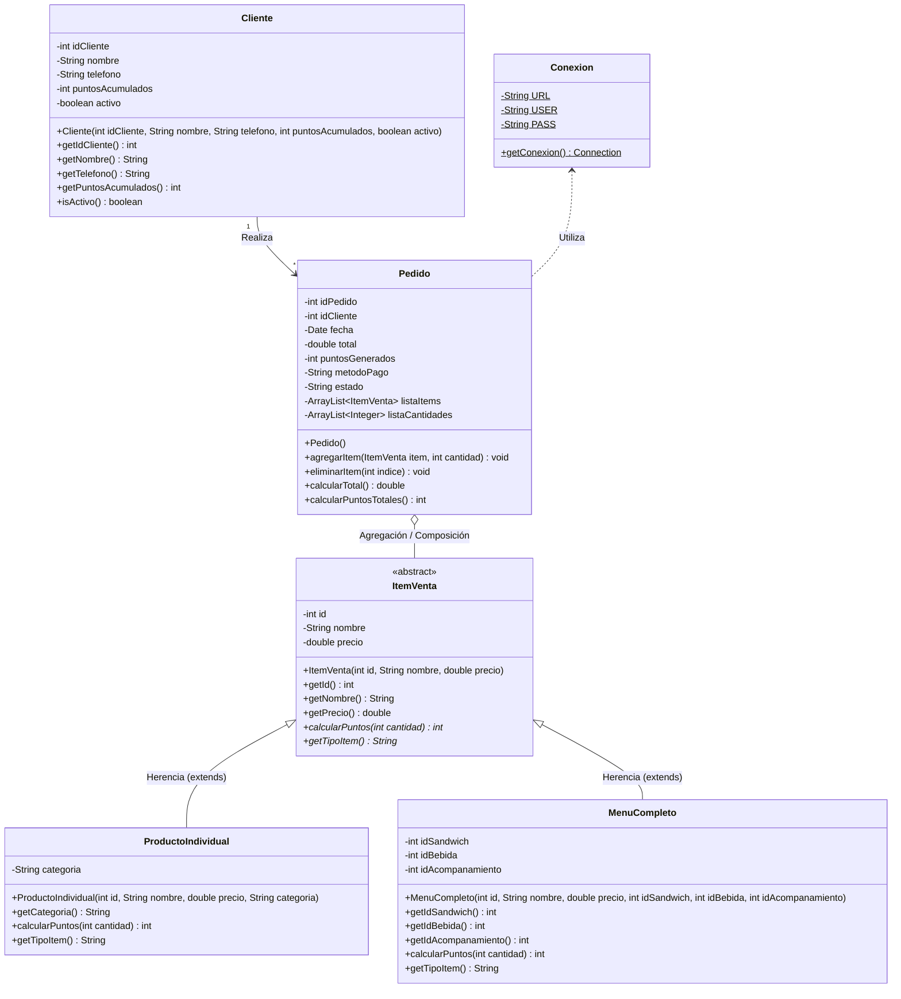

# Documentación de Diagramas - Pan, Puntos y Premios
**Sistema de Gestión de Pedidos y Fidelización para Restaurante de Sándwiches**  
**Lenguaje:** Java | **Base de Datos:** Oracle Database (XE) | **Arquitectura:** Swing / Web (JSP & Servlets)

---

## 1. Diagrama de Clases UML (Modelo Orientado a Objetos)

El siguiente diagrama modela la estructura de clases del sistema, destacando la jerarquía de **Herencia y Polimorfismo** implementada a través de `ItemVenta`, de la cual se derivan `ProductoIndividual` y `MenuCompleto` con la sobreescritura de `calcularPuntos()`.



### Justificación de POO:
* **Herencia y Polimorfismo:** `ItemVenta` define el contrato polimórfico mediante `calcularPuntos(int cantidad)`.
  * `ProductoIndividual` otorga `cantidad * 2` puntos únicamente si su categoría es `SANDWICH`. Bebidas y acompañamientos otorgan `0` puntos.
  * `MenuCompleto` otorga `cantidad * 8` puntos por combo adquirido.
* **Composición y Colecciones:** `Pedido` administra múltiples detalles mediante `ArrayList<ItemVenta>` y `ArrayList<Integer>`.

---

## 2. Diagrama Entidad-Relación (ER - Base de Datos Oracle)

El siguiente modelo relacional corresponde al esquema implementado en Oracle Database, garantizando integridad referencial y restricciones transaccionales (`ACID`).

```mermaid
erDiagram
    CLIENTE ||--o{ PEDIDO : "1:N realiza"
    CLIENTE ||--o{ HISTORIAL_PUNTOS : "1:N acumula / canjea"
    PEDIDO ||--|{ DETALLE_PEDIDO : "1:N contiene"
    PRODUCTO ||--o{ DETALLE_PEDIDO : "1:N se factura como item"
    PRODUCTO ||--o{ HISTORIAL_INVENTARIO : "1:N registra movimientos"
    PRODUCTO ||--o{ MENU : "1:N compone como insumo"
    MENU ||--o{ DETALLE_PEDIDO : "1:N se factura como combo"

    CLIENTE {
        NUMBER id_cliente PK
        VARCHAR2(100) nombre "NN"
        VARCHAR2(15) telefono "NN"
        NUMBER puntos_acumulados "DEFAULT 0, >= 0"
        NUMBER(1) activo "IN (0, 1)"
    }

    PRODUCTO {
        NUMBER id_producto PK
        VARCHAR2(100) nombre "NN"
        VARCHAR2(30) categoria "IN ('SANDWICH', 'BEBIDA', 'ACOMPANAMIENTO')"
        NUMBER(8,2) precio ">= 0, NN"
        NUMBER existencia ">= 0, NN"
        NUMBER(1) activo "IN (0, 1)"
    }

    MENU {
        NUMBER id_menu PK
        VARCHAR2(100) nombre "NN"
        NUMBER(8,2) precio ">= 0, NN"
        NUMBER id_sandwich FK "PRODUCTO.id_producto"
        NUMBER id_bebida FK "PRODUCTO.id_producto"
        NUMBER id_acompanamiento FK "PRODUCTO.id_producto"
        NUMBER(1) activo "IN (0, 1)"
    }

    PEDIDO {
        NUMBER id_pedido PK
        NUMBER id_cliente FK "CLIENTE.id_cliente"
        DATE fecha "DEFAULT SYSDATE"
        NUMBER(8,2) total ">= 0, NN"
        NUMBER puntos_generados "DEFAULT 0"
        VARCHAR2(20) metodo_pago "IN ('EFECTIVO', 'TARJETA')"
        VARCHAR2(20) estado "IN ('PENDIENTE', 'PAGADO', 'ENTREGADO', 'ANULADO')"
    }

    DETALLE_PEDIDO {
        NUMBER id_detalle PK
        NUMBER id_pedido FK "PEDIDO.id_pedido"
        VARCHAR2(20) tipo_item "IN ('PRODUCTO', 'MENU')"
        NUMBER id_item "NN"
        NUMBER cantidad "> 0, NN"
        NUMBER(8,2) precio_unitario "NN"
        NUMBER(8,2) subtotal "NN"
    }

    HISTORIAL_INVENTARIO {
        NUMBER id_movimiento PK
        NUMBER id_producto FK "PRODUCTO.id_producto"
        DATE fecha "DEFAULT SYSDATE"
        NUMBER cantidad "NN"
        VARCHAR2(20) tipo_movimiento "IN ('INGRESO', 'VENTA', 'CANJE')"
    }

    HISTORIAL_PUNTOS {
        NUMBER id_movimiento PK
        NUMBER id_cliente FK "CLIENTE.id_cliente"
        DATE fecha "DEFAULT SYSDATE"
        VARCHAR2(20) tipo "IN ('ACUMULACION', 'CANJE')"
        NUMBER puntos "NN"
        VARCHAR2(200) descripcion
    }
```

---

## 3. Resumen de Módulos y Flujos Transaccionales

1. **Gestión de Clientes:** Saldo inicial forzado a 0 puntos. Búsqueda por identificador o teléfono. Desactivación lógica (`activo = 0`).
2. **Gestión de Productos:** Restricciones de precio y existencia no negativos.
3. **Abastecimiento:** Aumento de existencias y registro obligatorio en `HISTORIAL_INVENTARIO` ('INGRESO').
4. **Cobro y Transaccionalidad:** `setAutoCommit(false)` con `commit()` y `rollback()`.
   * Descuento de existencias individual o por los 3 componentes del combo.
   * Acreditación de puntos calculados por polimorfismo.
   * Registro simultáneo en `PEDIDO`, `DETALLE_PEDIDO`, `HISTORIAL_INVENTARIO` y `HISTORIAL_PUNTOS`.
5. **Canje de Recompensas:**
   * Bebida Gratuita: **10 pts**
   * Acompañamiento Gratuito: **15 pts**
   * Sándwich Individual Gratuito: **30 pts**
   * Menú Completo Gratuito: **50 pts**
   * Validación estricta de saldo suficiente y stock disponible antes de efectuar el débito.
6. **Reportes:** 6 consultas con métricas de ventas, desglose efectivo/tarjeta, productos más vendidos, alertas de stock bajo ($\le 5$), puntos y canjes.
