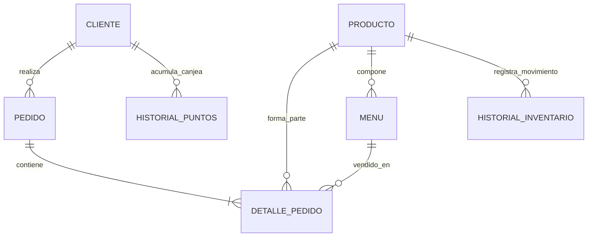

# Manual Completo del Proyecto: Pan, Puntos y Premios
**Guía Paso a Paso y Manual de Exposición**  
*Autor: Tito Gómez | Sistema de Ventas, Inventario y Fidelización*

---

## 1. Introducción al Proyecto
El proyecto **Pan, Puntos y Premios** es un sistema integral desarrollado para un restaurante especializado en sándwiches individuales y menús completos (combos). Resuelve cuatro necesidades fundamentales:
1. **Punto de Venta (POS):** Facturación rápida con pagos en efectivo y tarjeta.
2. **Control de Inventario:** Existencias en tiempo real y abastecimiento con historial.
3. **Programa de Fidelización:** Acumulación automática de puntos por compras y canje por productos gratuitos.
4. **Reportes Administrativos:** 6 reportes de negocio visualizados en tablas.

El sistema fue diseñado originalmente como una **aplicación de escritorio en Java Swing** con base de datos **Oracle Database XE**, y posteriormente evolucionó a una **aplicación web moderna en JSP/Servlets** conectada a la nube (**Supabase**) y desplegada en producción (**Railway / Render**).

---

## 2. Paso 1: Diseño y Construcción de la Base de Datos

### A. Estructura de las Tablas (Modelo Relacional)
El sistema se compone de 7 tablas relacionadas entre sí con integridad referencial:



1. **`CLIENTE`**: Almacena clientes, sus teléfonos, puntos acumulados y su estado (`activo = 1` o `0`).
2. **`PRODUCTO`**: Almacena los ítems individuales: código, nombre, categoría (`SANDWICH`, `BEBIDA`, `ACOMPANAMIENTO`), precio y existencia física.
3. **`MENU`**: Representa los combos completos. En lugar de ser un producto físico en bodega, guarda las referencias al sándwich (`id_sandwich`), bebida (`id_bebida`) y acompañamiento (`id_acompanamiento`) que lo componen.
4. **`PEDIDO`**: Cabecera de la factura con fecha, cliente, total a pagar, puntos ganados, método de pago (`EFECTIVO` o `TARJETA`) y estado (`PAGADO`, `PENDIENTE`, etc.).
5. **`DETALLE_PEDIDO`**: Detalle de la factura. Permite agregar tanto productos individuales como combos a un mismo pedido.
6. **`HISTORIAL_INVENTARIO`**: Bitácora que registra cada entrada (`INGRESO`), salida por venta (`VENTA`) o salida por premio (`CANJE`).
7. **`HISTORIAL_PUNTOS`**: Bitácora que registra cada punto acreditado por compra (`ACUMULACION`) o descontado por premio (`CANJE`).

### B. Reglas de Negocio en la Base de Datos (Restricciones CHECK)
* Los precios y existencias **nunca** pueden ser negativos (`precio >= 0`, `existencia >= 0`).
* Las categorías están restringidas a: `'SANDWICH'`, `'BEBIDA'`, `'ACOMPANAMIENTO'`.
* Métodos de pago permitidos: `'EFECTIVO'`, `'TARJETA'`.

### C. Estrategia de Dos Bases de Datos
* **Oracle Database XE (Local en tu PC):** Es la base de datos principal para la rúbrica y evaluación en el aula con el profesor.
* **Supabase (PostgreSQL en la Nube):** Es la réplica en la nube para permitir que la página web funcione en internet las 24 horas.

---

## 3. Paso 2: Arquitectura Orientada a Objetos (POO en Java)

Para cumplir con la rúbrica de Programación Orientada a Objetos, se aplicaron los siguientes conceptos:

### A. Herencia y Polimorfismo (`ItemVenta`)
Se definió una clase base abstracta:
* **`ItemVenta.java` (Clase Abstracta):** Contiene los atributos comunes (`id`, `nombre`, `precio`) y declara el método abstracto:
  ```java
  public abstract int calcularPuntos(int cantidad);
  ```
* **`ProductoIndividual.java` (Subclase):** Hereda de `ItemVenta`. Si la categoría es `'SANDWICH'`, otorga **2 puntos** por unidad. Si es bebida o acompañamiento, retorna **0 puntos**.
  ```java
  public int calcularPuntos(int cantidad) {
      if ("SANDWICH".equalsIgnoreCase(this.categoria)) {
          return cantidad * 2;
      }
      return 0;
  }
  ```
* **`MenuCompleto.java` (Subclase):** Hereda de `ItemVenta`. Por regla de negocio, cada combo otorga **8 puntos**.
  ```java
  public int calcularPuntos(int cantidad) {
      return cantidad * 8;
  }
  ```

### B. Encapsulamiento, Colecciones y Transacciones
* **Encapsulamiento:** Todos los atributos son privados (`private`) y se accede a ellos únicamente mediante getters y setters.
* **Colecciones (`ArrayList`):** En `FrmPedido` se utiliza una lista dinámica para gestionar los ítems agregados al pedido antes de confirmar la compra.
* **Transacciones ACID:** Al procesar un pedido o un canje, se ejecuta `cn.setAutoCommit(false)`. Si todo sale bien se ejecuta `cn.commit()`; si ocurre un error, se ejecuta `cn.rollback()` para que el inventario y los puntos nunca queden inconsistentes.

---

## 4. Paso 3: Aplicación de Escritorio en Java Swing (NetBeans)

La aplicación de escritorio se compone de 8 ventanas diseñadas con componentes estándar de Swing (`JFrame`, `JTable`, `JComboBox`, `JTextField`, `JButton`):

1. **`FrmPrincipal`:** Menú principal con accesos rápidos a cada módulo.
2. **`FrmCliente`:**
   * Búsqueda por ID o teléfono.
   * Registro con saldo inicial en 0 puntos.
   * Modificación de datos y **desactivación lógica** (`activo = 0`) para preservar el historial de compras.
3. **`FrmProducto`:**
   * Mantenimiento del catálogo de sándwiches, bebidas y acompañamientos.
   * Validación para no permitir precios ni stock negativos.
4. **`FrmAbastecimiento`:**
   * Permite ingresar nuevas existencias a los productos y genera automáticamente el registro en `HISTORIAL_INVENTARIO`.
5. **`FrmPedido` (Punto de Venta - POS):**
   * Búsqueda de cliente y visualización de sus puntos acumulados.
   * Selección de productos individuales o menús completos con cantidades.
   * Al vender un Menú Completo, descuenta 1 unidad del sándwich, 1 de la bebida y 1 del acompañamiento (no un cuarto producto).
   * Cálculo automático de puntos mediante polimorfismo: $P = (S \times 2) + (M \times 8)$.
   * Cobro en efectivo con cálculo de cambio, o cobro simulado con tarjeta ingresando número de referencia.
6. **`FrmCanje`:**
   * Permite al cliente canjear sus puntos por recompensas oficiales:
     * Bebida gratuita = 10 pts
     * Acompañamiento gratuito = 15 pts
     * Sándwich individual gratuito = 30 pts
     * Menú completo gratuito = 50 pts
   * Valida existencias y puntos suficientes antes de descontar.
7. **`FrmReportes`:**
   * Implementa los 6 reportes obligatorios visualizados en `JTable`:
     1. Ventas por período (desglose efectivo vs tarjeta).
     2. Productos más vendidos.
     3. Productos agotados o con stock bajo ($\le 5$).
     4. Puntos acumulados por cliente.
     5. Historial de canjes realizados.
     6. Ventas de menús completos.

---

## 5. Paso 4: De Escritorio a la Web (JSP y Servlets)

Para transformar el proyecto en una aplicación web accesible desde cualquier navegador:

1. **La Interfaz Web (`index.jsp`):**
   * Se diseñó como una aplicación de una sola página (SPA) moderna con Bootstrap 5.
   * Cuenta con 6 pestañas que replican fielmente las ventanas de NetBeans: **Punto de Venta (POS)**, **Clientes**, **Productos**, **Inventario**, **Canjes** y **Reportes**.
2. **El Controlador Web (`PedidoServlet.java`):**
   * Actúa como el cerebro del servidor:
     * Método `doGet`: Consulta y responde datos en formato JSON para búsquedas y tablas.
     * Método `doPost`: Procesa operaciones de guardado (ventas, cobros, abastecimiento, canjes).
3. **La Conexión Dual (`Conexion.java`):**
   * Clase inteligente que detecta el entorno de ejecución:
     * Si corre en tu máquina con NetBeans $\rightarrow$ se conecta a **Oracle XE local**.
     * Si corre en la nube (Render / Railway) $\rightarrow$ se conecta a **Supabase**.

---

## 6. Paso 5: Despliegue en la Nube (Producción en Internet)

Para que cualquier persona desde su celular o computadora pueda interactuar con el sistema sin estar en tu computadora:

1. **Base de Datos en Supabase:**
   * Se creó un proyecto en la nube con las 7 tablas de PostgreSQL y datos de prueba.
2. **Contenedor Docker (`Dockerfile`):**
   * Se configuró un contenedor con Apache Tomcat 9 y Java 17 (`tomcat:9.0-jdk17-corretto`).
   * Se empaquetó la aplicación completa en `ROOT.war` para que responda en la raíz de la web.
3. **Plataformas de Nube (Railway / Render):**
   * Se conectaron directamente con tu repositorio de GitHub `Titog-o/Proyecto_PanPuntos`.
   * Enlaces públicos en vivo:
     * **Railway:** `https://proyectopanpuntos-production.up.railway.app/`
     * **Render:** `https://proyecto-panpuntos-wed.onrender.com/`

---

## 7. Guía para la Exposición (Preguntas Típicas del Docente)

El PDF indica que se realizarán preguntas sobre el funcionamiento y código, y cada respuesta incorrecta resta 2 puntos. Aquí tienes las respuestas exactas:

### P1: "¿Dónde se calculan los puntos de los sándwiches y menús?"
> **Respuesta:** *"Se calculan aplicando polimorfismo con la clase abstracta `ItemVenta`. La subclase `ProductoIndividual` sobreescribe el método `calcularPuntos` para otorgar 2 puntos si es sándwich y 0 si es bebida/acompañamiento. La subclase `MenuCompleto` otorga 8 puntos por cada combo."*

### P2: "¿Cómo evitas que un menú completo descuente un inventario erróneo?"
> **Respuesta:** *"El menú completo no existe como un cuarto producto físico en bodega. En `FrmPedido` y en `PedidoServlet`, al vender un combo se descuenta exactamente 1 unidad del sándwich, 1 unidad de la bebida y 1 del acompañamiento asociados a ese menú."*

### P3: "¿Dónde garantizas la integridad transaccional exigida en el punto 6?"
> **Respuesta:** *"En los métodos de venta y canje utilizamos transacciones JDBC. Antes de hacer las modificaciones ejecutamos `cn.setAutoCommit(false)`. Si se descuenta el stock y se registran los puntos exitosamente, hacemos `cn.commit()`. Si alguna validación falla, se ejecuta `cn.rollback()` dentro del bloque `catch` para evitar inconsistencias."*

### P4: "¿Por qué los clientes no se eliminan físicamente?"
> **Respuesta:** *"Para respetar la integridad referencial. Si un cliente ya tiene pedidos históricos en la tabla `PEDIDO`, eliminarlo causaría un error de llave foránea. Por eso implementamos desactivación lógica con `activo = 0`."*

### P5: "¿Cómo se cumple el punto extra de la aplicación móvil / Android?"
> **Respuesta:** *"Al tener la base de datos en Supabase y el servlet web en Railway, el sistema expone un endpoint REST público:  
`https://proyectopanpuntos-production.up.railway.app/PedidoServlet?accion=buscarCliente&criterio=1`  
Cualquier aplicación Android puede hacer una petición HTTP GET y consultar en formato JSON el saldo exacto de puntos del cliente en tiempo real."*

### P6: "¿Por qué el código no tiene comentarios?"
> **Respuesta:** *"Porque en la página 8 del documento, en las Consideraciones Finales, se especificó claramente que el código debía entregarse completamente limpio de comentarios."*
