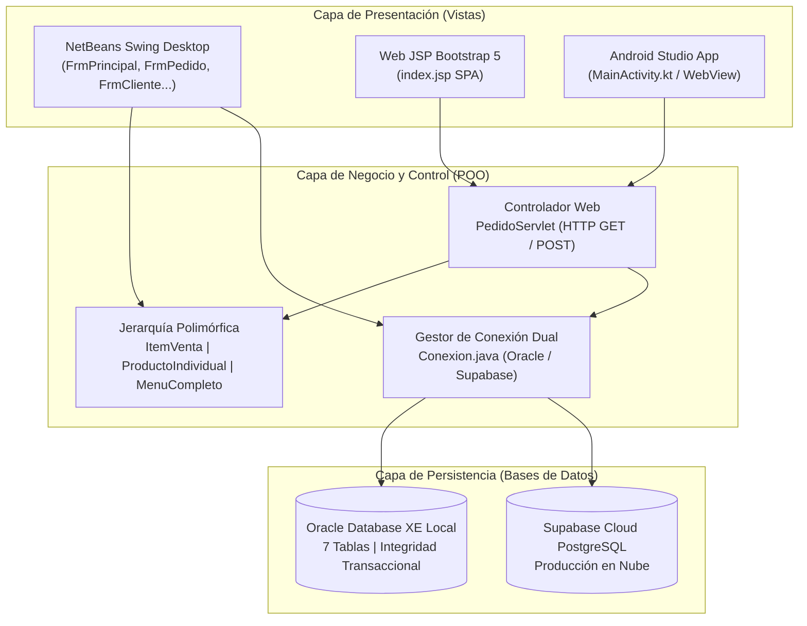
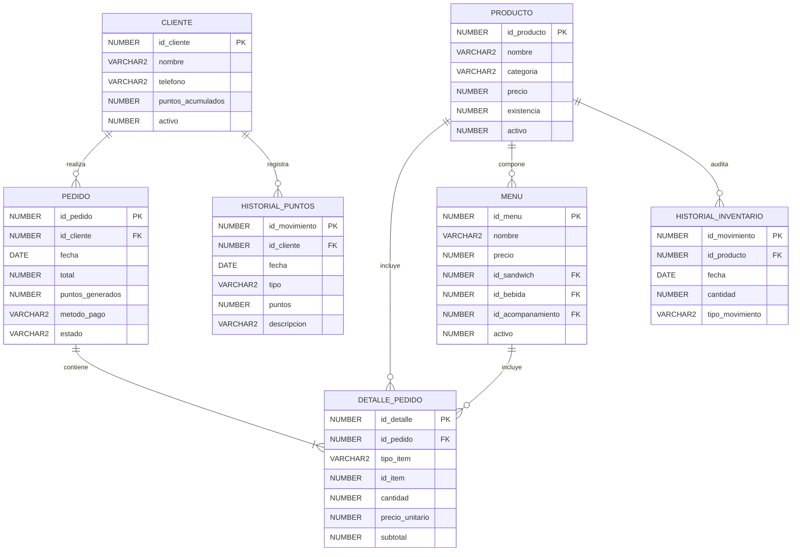

# Manual Técnico de Clases en NetBeans y Base de Datos Oracle
**Proyecto: Pan, Puntos y Premios - Sistema Integral de Gestión, Inventario y Fidelización**  
*Autor: Tito Gómez | Respaldo Técnico y Documentación de Arquitectura*

---

## 1. Arquitectura General del Sistema

El sistema implementa una arquitectura en capas desacoplada que permite operar tanto en entorno de escritorio (**Java Swing**) como en entorno web (**JSP / Servlets / Cloud**) sobre el mismo motor de persistencia (**Oracle Database XE** y réplica en **Supabase**).

---

## 2. Documentación Detallada de Clases en NetBeans

### A. Capa de Modelo y Programación Orientada a Objetos (POO)

#### 1. [`ItemVenta.java`](file:///C:/Users/Tito%20Gomez/Documents/NetBeansProjects/Proyecto_PanPuntos/src/proyecto_panpuntos/ItemVenta.java)
* **Paquete:** `proyecto_panpuntos`
* **Tipo:** Clase Abstracta (`abstract class`)
* **Propósito:** Modela el concepto general de cualquier elemento comercializable dentro del restaurante. Aplica el principio de **abstracción**, evitando que se instancien productos genéricos y obligando a las clases hijas a definir sus propias reglas de negocio.
* **Atributos:**
  * `private int id`: Código identificador único del ítem.
  * `private String nombre`: Nombre comercial del ítem.
  * `private double precio`: Precio de venta en Quetzales.
* **Métodos Principales:**
  * `ItemVenta(int id, String nombre, double precio)`: Constructor con parámetros que encapsula la inicialización.
  * `getId()`, `getNombre()`, `getPrecio()`: Métodos de acceso (*Getters*) que garantizan el encapsulamiento.
  * `public abstract int calcularPuntos(int cantidad)`: Método abstracto que implementa el **polimorfismo**. Cada subclase calcula los puntos según su tipo.
  * `public abstract String getTipoItem()`: Retorna el discriminador (`"PRODUCTO"` o `"MENU"`).

---

#### 2. [`ProductoIndividual.java`](file:///C:/Users/Tito%20Gomez/Documents/NetBeansProjects/Proyecto_PanPuntos/src/proyecto_panpuntos/ProductoIndividual.java)
* **Paquete:** `proyecto_panpuntos`
* **Tipo:** Clase Concreta (Extiende de [`ItemVenta`](file:///C:/Users/Tito%20Gomez/Documents/NetBeansProjects/Proyecto_PanPuntos/src/proyecto_panpuntos/ItemVenta.java))
* **Propósito:** Representa productos unitarios del catálogo: sándwiches, bebidas y acompañamientos.
* **Atributos:**
  * `private String categoria`: Clasificación del producto (`'SANDWICH'`, `'BEBIDA'`, `'ACOMPANAMIENTO'`).
* **Lógica Polimórfica:**
  * `calcularPuntos(int cantidad)`:
    * Si `categoria.equalsIgnoreCase("SANDWICH")` $\rightarrow$ Retorna `cantidad * 2` (Cumple la regla del PDF: **2 puntos por sándwich individual pagado**).
    * Si la categoría es `'BEBIDA'` o `'ACOMPANAMIENTO'` $\rightarrow$ Retorna `0` puntos.

---

#### 3. [`MenuCompleto.java`](file:///C:/Users/Tito%20Gomez/Documents/NetBeansProjects/Proyecto_PanPuntos/src/proyecto_panpuntos/MenuCompleto.java)
* **Paquete:** `proyecto_panpuntos`
* **Tipo:** Clase Concreta (Extiende de [`ItemVenta`](file:///C:/Users/Tito%20Gomez/Documents/NetBeansProjects/Proyecto_PanPuntos/src/proyecto_panpuntos/ItemVenta.java))
* **Propósito:** Modela los combos del menú. Aplica **composición lógica**, ya que un combo está conformado por la unión de 3 productos individuales.
* **Atributos:**
  * `private int idSandwich`: Código foráneo del sándwich que incluye.
  * `private int idBebida`: Código foráneo de la bebida que incluye.
  * `private int idAcompanamiento`: Código foráneo del acompañamiento que incluye.
* **Lógica Polimórfica:**
  * `calcularPuntos(int cantidad)`: Retorna `cantidad * 8` (Cumple la regla del PDF: **8 puntos por cada menú completo pagado**).
  * `getIdSandwich()`, `getIdBebida()`, `getIdAcompanamiento()`: Permiten al motor de cobro descontar los 3 insumos correspondientes en el inventario.

---

### B. Capa de Acceso a Datos y Conectividad

#### 4. [`Conexion.java`](file:///C:/Users/Tito%20Gomez/Documents/NetBeansProjects/Proyecto_PanPuntos/src/proyecto_panpuntos/Conexion.java)
* **Paquete:** `proyecto_panpuntos`
* **Propósito:** Administrador centralizado de conexiones JDBC. Diseñado con arquitectura de conmutación inteligente (*Failover*):
  * **Conexión Primaria (Local):** `jdbc:oracle:thin:@localhost:1521:XE` con usuario `system` y contraseña `1234`. Carga el driver `oracle.jdbc.OracleDriver`.
  * **Conexión Secundaria (Nube):** `jdbc:postgresql://aws-0-us-east-1.pooler.supabase.com:6543/postgres?sslmode=require`. Se activa automáticamente si el sistema detecta variables de entorno de nube (`RENDER`, `RAILWAY_ENVIRONMENT`, `PORT`) o si la base de datos Oracle local no responde.
* **Métodos Principales:**
  * `Connection getConexion()`: Provee conexiones activas a los formularios y servlets.
  * `Connection getConexionSupabase()`: Establece conexión con el clúster de Supabase mediante `org.postgresql.Driver`.

---

### C. Capa de Presentación de Escritorio (Formularios Swing)

#### 5. [`FrmPrincipal.java`](file:///C:/Users/Tito%20Gomez/Documents/NetBeansProjects/Proyecto_PanPuntos/src/proyecto_panpuntos/FrmPrincipal.java)
* **Tipo:** `JFrame`
* **Propósito:** Tablero de mando y menú central del sistema. Provee botones de navegación directa hacia:
  * Punto de Venta (`FrmPedido`)
  * Gestión de Clientes (`FrmCliente`)
  * Gestión de Productos (`FrmProducto`)
  * Abastecimiento (`FrmAbastecimiento`)
  * Canje de Puntos (`FrmCanje`)
  * Reportes Oficiales (`FrmReportes`)

---

#### 6. [`FrmCliente.java`](file:///C:/Users/Tito%20Gomez/Documents/NetBeansProjects/Proyecto_PanPuntos/src/proyecto_panpuntos/FrmCliente.java)
* **Tipo:** `JFrame` (Cumple **Requerimiento 1** del PDF)
* **Funciones:**
  * **Búsqueda:** Por ID numérico o teléfono mediante `PreparedStatement`.
  * **Registro:** Inserta nuevo cliente garantizando saldo inicial en cero (`puntos_acumulados = 0`) y estado `activo = 1`.
  * **Modificación:** Actualiza nombre y teléfono sin alterar los puntos ganados.
  * **Desactivación Lógica:** Aplica `UPDATE CLIENTE SET activo = 0 WHERE id_cliente = ?`. No realiza `DELETE` físico para preservar la integridad referencial de facturas anteriores.
  * **Visualización:** Lista todos los clientes en un `JTable` y permite consultar su historial de compras y bitácora de puntos.

---

#### 7. [`FrmProducto.java`](file:///C:/Users/Tito%20Gomez/Documents/NetBeansProjects/Proyecto_PanPuntos/src/proyecto_panpuntos/FrmProducto.java)
* **Tipo:** `JFrame` (Cumple **Requerimiento 2** del PDF)
* **Funciones:**
  * **Catálogo:** Mantenimiento de sándwiches, bebidas y acompañamientos.
  * **Validaciones de Entrada:** Comprueba que `precio >= 0` y `existencia >= 0`. Impide el registro de valores negativos.
  * **Integridad de Categorías:** Restringe la selección a los valores válidos de la base de datos (`'SANDWICH'`, `'BEBIDA'`, `'ACOMPANAMIENTO'`).
  * **Desactivación:** Permite desactivar productos agotados o descontinuados para impedir su venta.

---

#### 8. [`FrmAbastecimiento.java`](file:///C:/Users/Tito%20Gomez/Documents/NetBeansProjects/Proyecto_PanPuntos/src/proyecto_panpuntos/FrmAbastecimiento.java)
* **Tipo:** `JFrame` (Cumple **Requerimiento 3** del PDF)
* **Funciones:**
  * Permite al bodeguero buscar un producto por su código y visualizar su stock actual.
  * Solicita la cantidad a ingresar, validando que sea estrictamente mayor a cero.
  * **Operación Atómica:** Ejecuta dos sentencias SQL:
    1. Incrementa el inventario: `UPDATE PRODUCTO SET existencia = existencia + ? WHERE id_producto = ?`.
    2. Registra la auditoría: `INSERT INTO HISTORIAL_INVENTARIO (...) VALUES (..., ?, CURRENT_TIMESTAMP, ?, 'INGRESO')`.

---

#### 9. [`FrmPedido.java`](file:///C:/Users/Tito%20Gomez/Documents/NetBeansProjects/Proyecto_PanPuntos/src/proyecto_panpuntos/FrmPedido.java)
* **Tipo:** `JFrame` (Cumple **Requerimientos 4, 5, 8, 9 y 11** del PDF)
* **Componentes y Lógica:**
  * Incluye los **10 componentes obligatorios** especificados en la página 6 del PDF.
  * **Manejo de Colecciones:** Usa `ArrayList<ItemVenta>` y `DefaultTableModel` para gestionar los ítems agregados al pedido antes de confirmar la compra.
  * **Cálculo de Puntos Polimórfico:** Invoca `item.calcularPuntos(cantidad)`, sumando automáticamente $+2$ por cada sándwich y $+8$ por cada combo.
  * **Descuento de Combos:** Al confirmar la venta de un menú, descuenta 1 unidad del sándwich, 1 de la bebida y 1 del acompañamiento. No descuenta un cuarto producto.
  * **Cobro:**
    * *Efectivo:* Calcula automáticamente el cambio (`Cambio = Efectivo - Total`) y rechaza la venta si el dinero recibido es insuficiente.
    * *Tarjeta:* Simula la pasarela solicitando el número de referencia y confirmación de aprobación.
  * **Transaccionalidad:** Ejecuta `cn.setAutoCommit(false)`. Si la inserción en `PEDIDO`, `DETALLE_PEDIDO`, descuento de existencias y acreditación de puntos en `CLIENTE` e `HISTORIAL_PUNTOS` culmina con éxito, ejecuta `cn.commit()`. En caso de excepción, aplica `cn.rollback()`.

---

#### 10. [`FrmCanje.java`](file:///C:/Users/Tito%20Gomez/Documents/NetBeansProjects/Proyecto_PanPuntos/src/proyecto_panpuntos/FrmCanje.java)
* **Tipo:** `JFrame` (Cumple **Requerimientos 6 y 7** del PDF)
* **Funciones:**
  * Catálogo oficial de recompensas:
    * Bebida gratuita = 10 puntos
    * Acompañamiento gratuito = 15 puntos
    * Sándwich individual gratuito = 30 puntos
    * Menú completo gratuito = 50 puntos
  * **Validaciones Estrictas (Página 3 del PDF):**
    1. Cliente activo y existente.
    2. Saldo de puntos suficiente.
    3. Recompensa disponible y activa.
    4. Existencias físicas suficientes en bodega.
  * Si todas las condiciones se cumplen, descuenta los puntos al cliente, descuenta el stock del producto o combo, y genera comprobante con registro en `HISTORIAL_PUNTOS` (`CANJE`) y en `HISTORIAL_INVENTARIO` (`CANJE`).

---

#### 11. [`FrmReportes.java`](file:///C:/Users/Tito%20Gomez/Documents/NetBeansProjects/Proyecto_PanPuntos/src/proyecto_panpuntos/FrmReportes.java)
* **Tipo:** `JFrame` (Cumple **Requerimiento 14** del PDF)
* **Funciones:** Consulta la base de datos y renderiza en `JTable` los **6 reportes obligatorios**:
  1. **Ventas por período:** Rango de facturas pagadas, total vendido y desglose por método de pago (Efectivo vs Tarjeta).
  2. **Productos más vendidos:** Ranking de unidades vendidas agrupadas por producto.
  3. **Productos bajo inventario:** Alerta de productos con existencia $\le 5$ unidades o agotados ($0$).
  4. **Puntos por cliente:** Saldo acumulado ordenado de mayor a menor.
  5. **Historial de canjes:** Detalle de recompensas canjeadas por cliente con fecha y puntos utilizados.
  6. **Ventas de menús completos:** Cantidades y recaudación específica generada por cada combo.

---

#### 12. [`Proyecto_PanPuntos.java`](file:///C:/Users/Tito%20Gomez/Documents/NetBeansProjects/Proyecto_PanPuntos/src/proyecto_panpuntos/Proyecto_PanPuntos.java)
* **Tipo:** Clase Principal
* **Propósito:** Punto de entrada de la aplicación (`public static void main`). Configura el Look & Feel del sistema e inicializa la ventana principal [`FrmPrincipal`](file:///C:/Users/Tito%20Gomez/Documents/NetBeansProjects/Proyecto_PanPuntos/src/proyecto_panpuntos/FrmPrincipal.java).

---

### D. Capa Web (JSP y Servlets)

#### 13. [`PedidoServlet.java`](file:///C:/Users/Tito%20Gomez/Documents/NetBeansProjects/Proyecto_PanPuntos_Web/src/java/controladores/PedidoServlet.java)
* **Paquete:** `controladores`
* **Tipo:** `HttpServlet` (Mapeado a `/PedidoServlet`)
* **Propósito:** Controlador REST/JSON central que gestiona todas las peticiones asíncronas (`fetch`) desde la aplicación web y desde la aplicación Android.
* **Método `doGet`:** Atiende consultas de lectura:
  * `buscarCliente`: Retorna datos y saldo del cliente en JSON.
  * `listarClientes`: Devuelve array de clientes para tablas.
  * `buscarProducto`: Retorna información y existencia de un producto.
  * `listarProductos`: Catálogo completo en JSON.
  * `buscarItem`: Verifica disponibilidad y stock para venta POS.
  * `consultarPremio`: Comprueba existencias de recompensas para canje.
  * `generarReporte`: Ejecuta las consultas SQL de los 6 reportes oficiales y genera columnas y filas en JSON.
* **Método `doPost`:** Atiende operaciones de escritura y transacciones:
  * `guardarCliente`, `modificarCliente`, `desactivarCliente`
  * `guardarProducto`, `modificarProducto`, `desactivarProducto`
  * `abastecer`: Aumenta stock y audita inventario.
  * `procesarCanje`: Transacción de descuento de puntos y productos.
  * `(default - Cobro)`: Transacción completa de venta de pedidos con múltiples detalles, cálculo de cambio y acreditación de puntos.

---

#### 14. [`index.jsp`](file:///C:/Users/Tito%20Gomez/Documents/NetBeansProjects/Proyecto_PanPuntos_Web/web/index.jsp)
* **Propósito:** Interfaz de usuario web interactiva diseñada bajo arquitectura Single-Page Application (SPA) con Bootstrap 5.
* **Módulos:** Contiene 6 pestañas de navegación:
  1. *Punto de Venta:* Selección dinámica de productos/combos, carrito de compras, cálculo de cambio y cobro.
  2. *Clientes:* Registro, edición y búsqueda.
  3. *Productos:* Catálogo con badges de stock.
  4. *Inventario:* Módulo de abastecimiento rápido.
  5. *Canje de Puntos:* Selección de premios con validación de saldo.
  6. *Reportes:* Visualización de los 6 reportes oficiales en tablas HTML responsivas.

---

## 3. Diccionario de Datos: Base de Datos Oracle Database XE

El esquema en Oracle XE está normalizado en Tercera Forma Normal (3FN), compuesto por 7 tablas:

---

### Tabla 1: `CLIENTE`
Almacena el registro de los clientes del restaurante y su saldo de fidelización.

| Columna | Tipo de Dato Oracle | Nulo | Clave | Restricción / Valor por Defecto | Descripción |
| :--- | :--- | :---: | :---: | :--- | :--- |
| `id_cliente` | `NUMBER` | NO | **PK** | Identificador único | Código o DPI del cliente |
| `nombre` | `VARCHAR2(100)` | NO | - | - | Nombre completo |
| `telefono` | `VARCHAR2(15)` | SÍ | - | - | Número de teléfono de contacto |
| `puntos_acumulados` | `NUMBER` | NO | - | `DEFAULT 0`, `CHECK (puntos >= 0)` | Saldo actual de puntos del cliente |
| `activo` | `NUMBER(1)` | NO | - | `DEFAULT 1`, `CHECK (activo IN (0,1))` | 1 = Activo, 0 = Desactivado |

---

### Tabla 2: `PRODUCTO`
Catálogo de ítems individuales y control físico de existencias.

| Columna | Tipo de Dato Oracle | Nulo | Clave | Restricción / Valor por Defecto | Descripción |
| :--- | :--- | :---: | :---: | :--- | :--- |
| `id_producto` | `NUMBER` | NO | **PK** | Identificador único | Código del producto |
| `nombre` | `VARCHAR2(100)` | NO | - | - | Descripción del producto |
| `categoria` | `VARCHAR2(30)` | NO | - | `CHECK (categoria IN ('SANDWICH', 'BEBIDA', 'ACOMPANAMIENTO'))` | Clasificación oficial del producto |
| `precio` | `NUMBER(8,2)` | NO | - | `CHECK (precio >= 0)` | Precio unitario de venta (Q) |
| `existencia` | `NUMBER` | NO | - | `CHECK (existencia >= 0)` | Stock físico disponible en bodega |
| `activo` | `NUMBER(1)` | NO | - | `DEFAULT 1`, `CHECK (activo IN (0,1))` | 1 = Disponible, 0 = Inactivo |

---

### Tabla 3: `MENU`
Estructura de combos completos (sándwich + bebida + acompañamiento).

| Columna | Tipo de Dato Oracle | Nulo | Clave | Restricción / Valor por Defecto | Descripción |
| :--- | :--- | :---: | :---: | :--- | :--- |
| `id_menu` | `NUMBER` | NO | **PK** | Identificador único | Código del combo |
| `nombre` | `VARCHAR2(100)` | NO | - | - | Nombre del combo (ej. Menú de Pollo) |
| `precio` | `NUMBER(8,2)` | NO | - | `CHECK (precio >= 0)` | Precio cerrado del menú completo |
| `id_sandwich` | `NUMBER` | NO | **FK** | Referencia a `PRODUCTO(id_producto)` | Sándwich que compone el combo |
| `id_bebida` | `NUMBER` | NO | **FK** | Referencia a `PRODUCTO(id_producto)` | Bebida que compone el combo |
| `id_acompanamiento` | `NUMBER` | NO | **FK** | Referencia a `PRODUCTO(id_producto)` | Acompañamiento del combo |
| `activo` | `NUMBER(1)` | NO | - | `DEFAULT 1`, `CHECK (activo IN (0,1))` | 1 = Disponible, 0 = Inactivo |

---

### Tabla 4: `PEDIDO`
Cabecera de facturas de venta realizadas en el restaurante.

| Columna | Tipo de Dato Oracle | Nulo | Clave | Restricción / Valor por Defecto | Descripción |
| :--- | :--- | :---: | :---: | :--- | :--- |
| `id_pedido` | `NUMBER` | NO | **PK** | Identificador único correlativo | Número de factura / pedido |
| `id_cliente` | `NUMBER` | NO | **FK** | Referencia a `CLIENTE(id_cliente)` | Cliente al que se factura |
| `fecha` | `DATE` | NO | - | `DEFAULT SYSDATE` | Fecha y hora exacta de la compra |
| `total` | `NUMBER(8,2)` | NO | - | `total >= 0` | Monto final facturado |
| `puntos_generados` | `NUMBER` | NO | - | `DEFAULT 0` | Puntos otorgados por la compra |
| `metodo_pago` | `VARCHAR2(20)` | NO | - | `CHECK (metodo_pago IN ('EFECTIVO', 'TARJETA'))` | Forma de pago utilizada |
| `estado` | `VARCHAR2(20)` | NO | - | `CHECK (estado IN ('PENDIENTE', 'PAGADO', 'ENTREGADO', 'ANULADO'))` | Estado del ciclo de vida del pedido |

---

### Tabla 5: `DETALLE_PEDIDO`
Líneas de detalle que componen cada orden de venta.

| Columna | Tipo de Dato Oracle | Nulo | Clave | Restricción / Valor por Defecto | Descripción |
| :--- | :--- | :---: | :---: | :--- | :--- |
| `id_detalle` | `NUMBER` | NO | **PK** | Identificador único | Correlativo del ítem en factura |
| `id_pedido` | `NUMBER` | NO | **FK** | Referencia a `PEDIDO(id_pedido)` | Pedido al que pertenece la línea |
| `tipo_item` | `VARCHAR2(20)` | NO | - | `CHECK (tipo_item IN ('PRODUCTO', 'MENU'))` | Discriminador de tipo de ítem |
| `id_item` | `NUMBER` | NO | - | Código del producto o del menú | Referencia al ítem vendido |
| `cantidad` | `NUMBER` | NO | - | `CHECK (cantidad > 0)` | Unidades adquiridas |
| `precio_unitario` | `NUMBER(8,2)` | NO | - | `precio_unitario >= 0` | Precio unitario aplicado |
| `subtotal` | `NUMBER(8,2)` | NO | - | `subtotal = cantidad * precio` | Importe total de la línea |

---

### Tabla 6: `HISTORIAL_INVENTARIO`
Bitácora de auditoría de movimientos físicos de stock.

| Columna | Tipo de Dato Oracle | Nulo | Clave | Restricción / Valor por Defecto | Descripción |
| :--- | :--- | :---: | :---: | :--- | :--- |
| `id_movimiento` | `NUMBER` | NO | **PK** | Identificador único correlativo | Código del movimiento |
| `id_producto` | `NUMBER` | NO | **FK** | Referencia a `PRODUCTO(id_producto)` | Producto afectado |
| `fecha` | `DATE` | NO | - | `DEFAULT SYSDATE` | Fecha y hora del movimiento |
| `cantidad` | `NUMBER` | NO | - | Cantidad movilizada | Unidades ingresadas o egresadas |
| `tipo_movimiento` | `VARCHAR2(20)` | NO | - | `CHECK (tipo_movimiento IN ('INGRESO', 'VENTA', 'CANJE'))` | Causa del movimiento de inventario |

---

### Tabla 7: `HISTORIAL_PUNTOS`
Bitácora de auditoría de movimientos del saldo de fidelización.

| Columna | Tipo de Dato Oracle | Nulo | Clave | Restricción / Valor por Defecto | Descripción |
| :--- | :--- | :---: | :---: | :--- | :--- |
| `id_movimiento` | `NUMBER` | NO | **PK** | Identificador único correlativo | Código del movimiento |
| `id_cliente` | `NUMBER` | NO | **FK** | Referencia a `CLIENTE(id_cliente)` | Cliente acreditado o debitado |
| `fecha` | `DATE` | NO | - | `DEFAULT SYSDATE` | Fecha y hora de la transacción |
| `tipo` | `VARCHAR2(20)` | NO | - | `CHECK (tipo IN ('ACUMULACION', 'CANJE'))` | Operación realizada |
| `puntos` | `NUMBER` | NO | - | Cantidad de puntos | Puntos sumados o restados |
| `descripcion` | `VARCHAR2(200)` | SÍ | - | - | Motivo (ej. "Compra Pedido #5", "Canje: Gaseosa") |

---

## 4. Matriz de Requerimientos del PDF vs Clases y Tablas

| Requerimiento Oficial del PDF | Clases Java Responsables | Tablas de Oracle Involucradas |
| :--- | :--- | :--- |
| **Req 1: Gestión de clientes** | [`FrmCliente`](file:///C:/Users/Tito%20Gomez/Documents/NetBeansProjects/Proyecto_PanPuntos/src/proyecto_panpuntos/FrmCliente.java), [`PedidoServlet`](file:///C:/Users/Tito%20Gomez/Documents/NetBeansProjects/Proyecto_PanPuntos_Web/src/java/controladores/PedidoServlet.java) | `CLIENTE`, `PEDIDO`, `HISTORIAL_PUNTOS` |
| **Req 2: Gestión de productos** | [`FrmProducto`](file:///C:/Users/Tito%20Gomez/Documents/NetBeansProjects/Proyecto_PanPuntos/src/proyecto_panpuntos/FrmProducto.java), [`PedidoServlet`](file:///C:/Users/Tito%20Gomez/Documents/NetBeansProjects/Proyecto_PanPuntos_Web/src/java/controladores/PedidoServlet.java) | `PRODUCTO` |
| **Req 3: Abastecimiento inventario** | [`FrmAbastecimiento`](file:///C:/Users/Tito%20Gomez/Documents/NetBeansProjects/Proyecto_PanPuntos/src/proyecto_panpuntos/FrmAbastecimiento.java), [`PedidoServlet`](file:///C:/Users/Tito%20Gomez/Documents/NetBeansProjects/Proyecto_PanPuntos_Web/src/java/controladores/PedidoServlet.java) | `PRODUCTO`, `HISTORIAL_INVENTARIO` |
| **Req 4 y 5: Gestión de pedidos** | [`FrmPedido`](file:///C:/Users/Tito%20Gomez/Documents/NetBeansProjects/Proyecto_PanPuntos/src/proyecto_panpuntos/FrmPedido.java), [`ItemVenta`](file:///C:/Users/Tito%20Gomez/Documents/NetBeansProjects/Proyecto_PanPuntos/src/proyecto_panpuntos/ItemVenta.java), [`PedidoServlet`](file:///C:/Users/Tito%20Gomez/Documents/NetBeansProjects/Proyecto_PanPuntos_Web/src/java/controladores/PedidoServlet.java) | `PEDIDO`, `DETALLE_PEDIDO`, `PRODUCTO`, `MENU` |
| **Req 6 y 7: Fidelización y canje** | [`FrmCanje`](file:///C:/Users/Tito%20Gomez/Documents/NetBeansProjects/Proyecto_PanPuntos/src/proyecto_panpuntos/FrmCanje.java), [`PedidoServlet`](file:///C:/Users/Tito%20Gomez/Documents/NetBeansProjects/Proyecto_PanPuntos_Web/src/java/controladores/PedidoServlet.java) | `CLIENTE`, `HISTORIAL_PUNTOS`, `PRODUCTO`, `HISTORIAL_INVENTARIO` |
| **Req 8: Pagos efectivo y tarjeta** | [`FrmPedido`](file:///C:/Users/Tito%20Gomez/Documents/NetBeansProjects/Proyecto_PanPuntos/src/proyecto_panpuntos/FrmPedido.java), [`PedidoServlet`](file:///C:/Users/Tito%20Gomez/Documents/NetBeansProjects/Proyecto_PanPuntos_Web/src/java/controladores/PedidoServlet.java) | `PEDIDO` |
| **Req 12 y 16: Integridad transaccional** | [`Conexion`](file:///C:/Users/Tito%20Gomez/Documents/NetBeansProjects/Proyecto_PanPuntos/src/proyecto_panpuntos/Conexion.java), [`FrmPedido`](file:///C:/Users/Tito%20Gomez/Documents/NetBeansProjects/Proyecto_PanPuntos/src/proyecto_panpuntos/FrmPedido.java), [`FrmCanje`](file:///C:/Users/Tito%20Gomez/Documents/NetBeansProjects/Proyecto_PanPuntos/src/proyecto_panpuntos/FrmCanje.java) | Todas las tablas (Manejo de `commit`/`rollback`) |
| **Req 13: Aplicación de POO** | [`ItemVenta`](file:///C:/Users/Tito%20Gomez/Documents/NetBeansProjects/Proyecto_PanPuntos/src/proyecto_panpuntos/ItemVenta.java), [`ProductoIndividual`](file:///C:/Users/Tito%20Gomez/Documents/NetBeansProjects/Proyecto_PanPuntos/src/proyecto_panpuntos/ProductoIndividual.java), [`MenuCompleto`](file:///C:/Users/Tito%20Gomez/Documents/NetBeansProjects/Proyecto_PanPuntos/src/proyecto_panpuntos/MenuCompleto.java) | `PRODUCTO`, `MENU` |
| **Req 14: Reportes JTable** | [`FrmReportes`](file:///C:/Users/Tito%20Gomez/Documents/NetBeansProjects/Proyecto_PanPuntos/src/proyecto_panpuntos/FrmReportes.java), [`PedidoServlet`](file:///C:/Users/Tito%20Gomez/Documents/NetBeansProjects/Proyecto_PanPuntos_Web/src/java/controladores/PedidoServlet.java) | `PEDIDO`, `DETALLE_PEDIDO`, `PRODUCTO`, `CLIENTE`, `HISTORIAL_PUNTOS` |
| **Puntos Extra: Consulta Móvil** | [`MainActivity.kt`](file:///C:/Users/Tito%20Gomez/Documents/AndroipStudio/app/src/main/java/com/example/myapplicationsab/MainActivity.kt), [`PedidoServlet`](file:///C:/Users/Tito%20Gomez/Documents/NetBeansProjects/Proyecto_PanPuntos_Web/src/java/controladores/PedidoServlet.java) | `CLIENTE` (Endpoint REST `/PedidoServlet?accion=buscarCliente`) |

---

## 5. Preguntas Clave para Responder Durante la Evaluación

> [!TIP]
> Si el docente te solicita explicar o modificar código durante la presentación, consulta los siguientes puntos de referencia rápida:

1. **"¿En qué clase se define la fórmula de puntos?"**
   * Señala [`ProductoIndividual.java`](file:///C:/Users/Tito%20Gomez/Documents/NetBeansProjects/Proyecto_PanPuntos/src/proyecto_panpuntos/ProductoIndividual.java) (para los 2 puntos del sándwich) y [`MenuCompleto.java`](file:///C:/Users/Tito%20Gomez/Documents/NetBeansProjects/Proyecto_PanPuntos/src/proyecto_panpuntos/MenuCompleto.java) (para los 8 puntos del combo), ambas sobreescribiendo el método `calcularPuntos` de [`ItemVenta.java`](file:///C:/Users/Tito%20Gomez/Documents/NetBeansProjects/Proyecto_PanPuntos/src/proyecto_panpuntos/ItemVenta.java).
2. **"¿Por qué un Menú Completo no tiene existencia física propia en la tabla `PRODUCTO`?"**
   * Porque un combo es una composición lógica. En [`FrmPedido.java`](file:///C:/Users/Tito%20Gomez/Documents/NetBeansProjects/Proyecto_PanPuntos/src/proyecto_panpuntos/FrmPedido.java) y [`PedidoServlet.java`](file:///C:/Users/Tito%20Gomez/Documents/NetBeansProjects/Proyecto_PanPuntos_Web/src/java/controladores/PedidoServlet.java), al venderse se descuentan los 3 insumos reales (`id_sandwich`, `id_bebida`, `id_acompanamiento`) de la tabla `PRODUCTO`.
3. **"¿Cómo se asegura que no queden datos a medias si se corta la conexión al pagar?"**
   * En [`FrmPedido.java`](file:///C:/Users/Tito%20Gomez/Documents/NetBeansProjects/Proyecto_PanPuntos/src/proyecto_panpuntos/FrmPedido.java) se desactiva el autoguardado con `cn.setAutoCommit(false)`. La orden solo se guarda permanentemente con `cn.commit()` si la factura, los detalles, el descuento de stock y la acreditación de puntos se ejecutan sin error; ante cualquier fallo, se ejecuta `cn.rollback()`.
4. **"¿Dónde está la base de datos de producción?"**
   * La base de datos local es **Oracle Database XE**, y para el funcionamiento de la página web y la aplicación móvil en internet, el sistema se conecta a la réplica en la nube alojada en **Supabase**.
